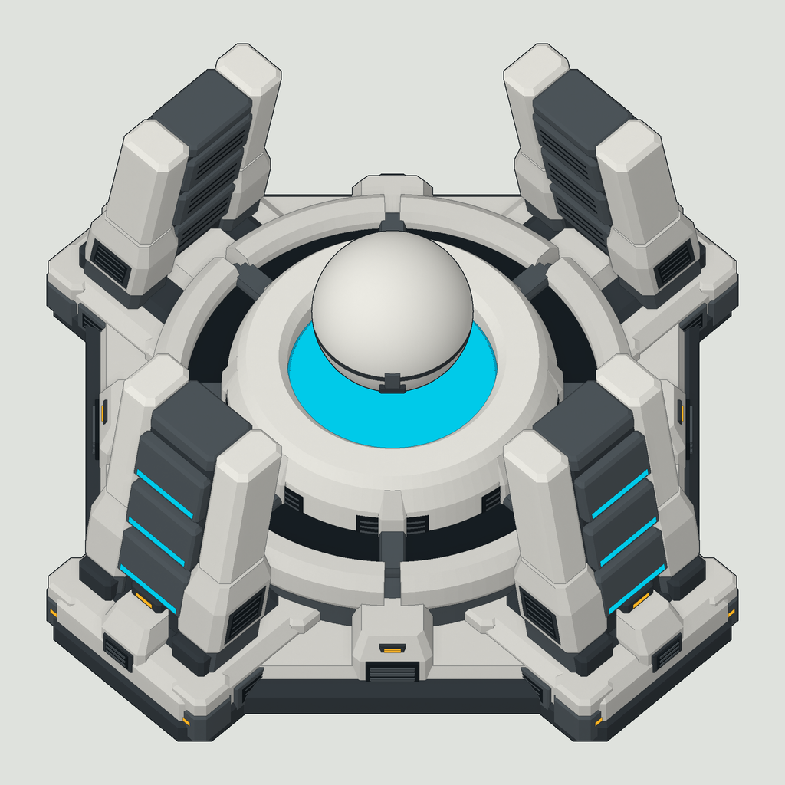
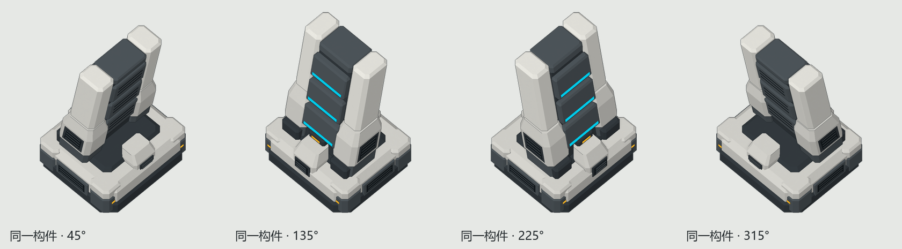

# Shield generator: shared corners and sprite layers

[中文说明](README.md) · [Framework](../../README.en.md)

This authoring example contains a four-corner shield-generator model, editable geometry scripts, OBJ exports and aligned sprite layers.



## Files

| File | Purpose |
|---|---|
| `build_model.py` | Generate and assemble the corners, base and orb, then export OBJ files |
| `primitives.py` | Build beveled boxes and solids from polygon cross-sections at different heights |
| `Models/shared_corner.obj` | One complete corner in local coordinates, including armor, foot and vents |
| `Models/shield_base.obj` | The assembled base and four corners |
| `Models/orb.obj` | The separate orb at its assembly position |
| `Models/materials.mtl` | Plain-color OBJ materials |
| `Models/structure-check.json` | Corner transforms, triangle counts and export checksums |
| `Images/base-1024.png`, `Images/orb-1024.png` | Transparent sprite layers with matching framing |
| `Images/camera.json` | Orthographic camera, canvas and positioning parameters |

## Generate the geometry

Python 3.10+ and its standard library are sufficient. From the repository root, run:

```text
python Modeling/ShieldGenerator/build_model.py --output Work/ShieldModel
```

Choose an empty output directory. The script exports `shared_corner.obj`, `shield_base.obj`, `orb.obj`, `materials.mtl` and `structure-check.json`. The two Python files can also be copied together and run with an explicit output path.

`build_master()` creates one complete corner. All four placements reuse its vertices and materials at 45°, 135°, 225° and 315°, with radius 1.68 and scale 1. Each placement rotates around Z before translating. `validate()` reverses those transforms and compares each corner against the master.

The exports contain 2362 triangles for one corner, 18120 for the base and 5104 for the orb. Zero-area faces at poles and lathe centers are omitted. For large numbers of visible instances, reduce curve segments and small details before measuring runtime cost.



## Layers and projection

X and Y form the ground plane; Z points up. Import the base and orb together with their original coordinates. The orb's assembly position is already included in its vertices.

`Images/base-1024.png` and `Images/orb-1024.png` share a 1024×1024 transparent canvas and a 55° orthographic view. Their framing is recorded in `Images/camera.json`. Overlay them at their original size. When rendering a changed model, frame the complete assembly once and keep the same camera and scale for both layers.

The supplied orb pose can be drawn over the base. Recheck occlusion if its height or the viewing angle changes. PNGs show the finished sprite appearance; OBJ materials are plain colors.

## Use with RMVF

This folder is an authoring reference and does not register a game building. Import the OBJ files into modeling software, make moving parts separate nodes, and follow the [GLB workflow](../../docs/quickstart.en.md#4-import-from-modeling-software).

OBJ preserves groups and materials but not the four shared instances. To edit them as instances, import `shared_corner.obj` and apply the placements in `structure-check.json`. For an independently moving orb, place its node origin at `(0,0,1.60)`, convert its vertices to that local origin, and bind a Z translation parameter.

RMVF provides flat shading and outlines; the sprite's surface texture is not imported as a runtime material. Shield interception, power rules and engine behavior belong to the gameplay mod.

The model and images originate from the Iron Curtain shield generator's shared-corner design and use the repository's [MIT license](../../LICENSE).
