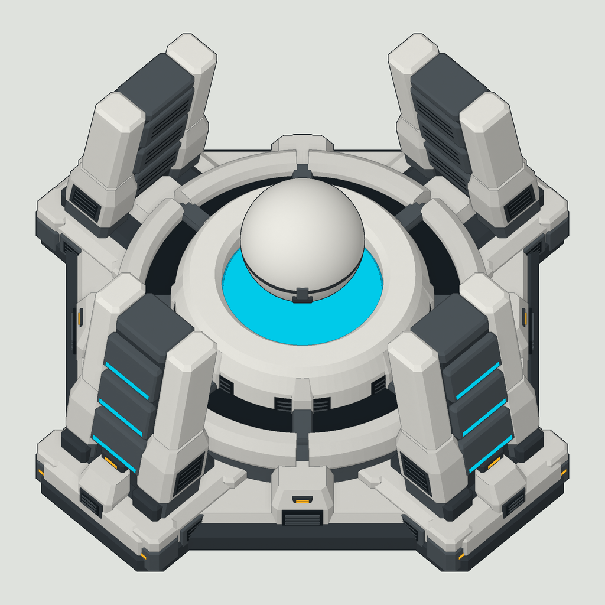
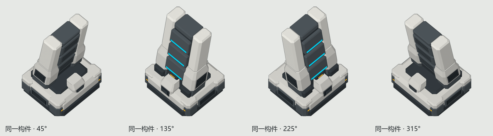

# 护盾发生器：统一构件与分层贴图

[English](README.en.md) · [返回框架首页](../../README.md)

这个案例展示如何从一个支架模型生成四角建筑，以及如何将中央球盖与基座分开制作。它提供可编辑的几何生成脚本、OBJ模型和贴图参考，供建模与导出流程使用。



## 文件与用途

|文件|用途|
|---|---|
|`build_model.py`|生成支架、基座和球盖，装配四个角并导出OBJ|
|`primitives.py`|倒角方柱、分层截面和环形结构的基本几何方法|
|`Models/shared_corner.obj`|位于局部原点的完整支架，包含装甲、脚座和散热口|
|`Models/shield_base.obj`|完整基座和四个支架|
|`Models/orb.obj`|独立球盖，保留装配时的位置|
|`Models/materials.mtl`|OBJ使用的纯色材质|
|`Models/structure-check.json`|四角变换、三角面数和导出文件校验值|
|`Images/base-1024.png`、`Images/orb-1024.png`|同一画布与定位的透明分层贴图|
|`Images/camera.json`|贴图使用的正交投影、画布尺寸和定位参数|

模型和图片来自铁幕护盾发生器的统一四角设计，采用本仓库的[MIT许可](../../LICENSE)。代码保留几何结构，改用Python标准库导出。PNG展示贴图完成后的外观，OBJ提供纯色几何；两者的表面质感和描边由各自绘制方式决定。

## 重新生成模型

需要Python 3.10+。在仓库根目录运行：

```text
python Modeling/ShieldGenerator/build_model.py --output Work/ShieldModel
```

输出目录须为空。生成内容包括三个OBJ、一份材质文件和结构检查结果。仅复制本目录中的两个Python文件到其他位置，也可以使用 `--output` 指定导出目录。

OBJ导入建模软件时，将 `shield_base.obj` 和 `orb.obj` 放在同一坐标系，保持原坐标。球盖的位置已经包含在顶点中，单独导入后再次自动居中会破坏对齐。坐标约定为X、Y构成地面，Z向上。

## 四个角如何保持一致

`build_master()`只创建一个完整支架。`MASTER`保存其局部顶点和材质，四个角分别使用45°、135°、225°、315°的旋转角，放在距中心1.68个模型单位的位置。

每个角先绕Z轴旋转，再整体平移。装甲、散热口、支架背板和脚座一起变换，四个角均使用相同尺度。修改主构件后重新运行脚本，四个角会同步更新。

`validate()`将每个角反向变换回局部空间，逐个比较顶点和材质。这个检查能发现漏转部件、单独缩放或错放位置。



基座导出为18120个三角面，球盖为5104个三角面，单独支架为2362个三角面。导出时略去球极点和旋转体中心处的零面积三角形。几何细节较多；用于大量同屏对象时，应先减少曲面分段和细小装饰，并测量运行开销。

## 分层贴图与相机

附带的基座和球盖PNG均为1024×1024透明画布，使用同一个55°俯角的正交相机。保持原尺寸直接叠放即可对齐。模型投影的完整位置参数在 `Images/camera.json` 中。

修改模型后重新制作贴图时，先用完整建筑确定画面范围，再固定相机、画布和比例，分别输出基座与球盖。两层各自裁切透明边缘或分别自动适应画面，会改变它们的相对位置。

球盖可以在游戏中单独绘制并上下移动。附图的静止位置可将球盖叠在基座上；改变球盖高度或相机角度后，需要重新检查它与支架的前后遮挡关系。

## 接入框架

这份资料是建模案例，当前不注册游戏建筑。要接入RMVF，可在建模软件中导入OBJ，将需要独立活动的部分设为独立节点，再按[GLB导入步骤](../../docs/quickstart.md#4-从建模软件接入)导出并编译。

OBJ保存顶点、分组和材质，不保存本例四角之间的实例关系。希望保留共享构件编辑方式时，可导入 `shared_corner.obj`，按检查文件中的变换创建四个实例。

为球盖建立动画节点时，将其原点设在球心 `(0,0,1.60)`，并将顶点转换为相对于球心的坐标。在框架中给该节点绑定Z轴平移参数，即可制作独立升降。框架采用平面明暗与粗描边，PNG中的表面纹理不会随OBJ自动成为运行时材质。

护盾拦截、电量变化和逆重引擎行为属于游戏逻辑，需要由使用这些素材的MOD实现。
