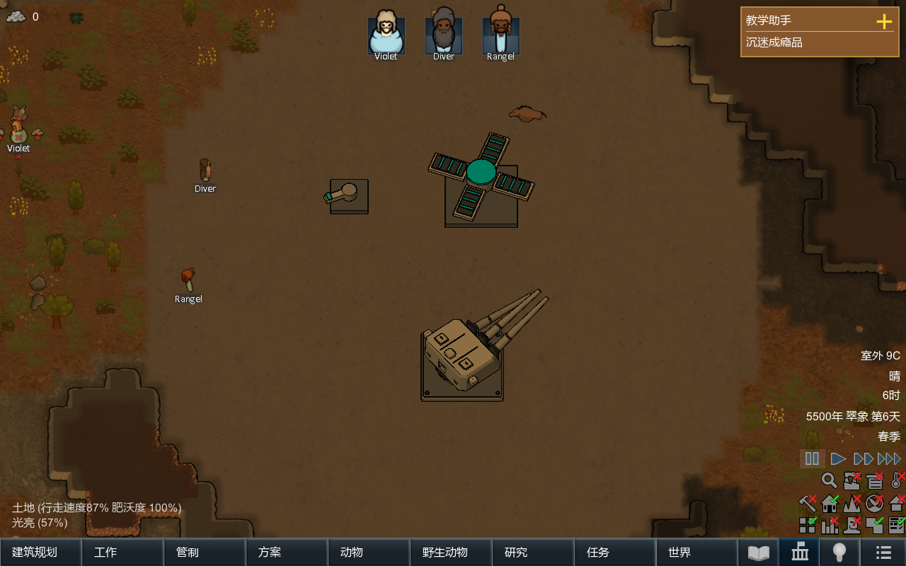
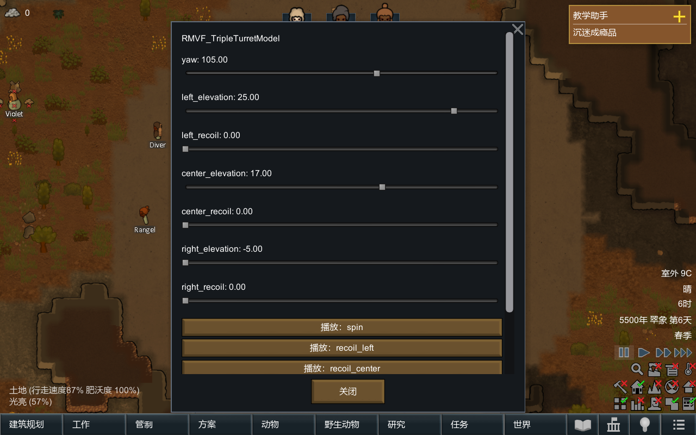

# From an empty folder to an animated building

[中文](quickstart.md) · [English home](../README.en.md) · [Model format](model-format.en.md) · [API](api.en.md)

This guide covers installing the examples, creating a mod, editing a model and importing parts from modeling software. Run the command-line steps from the root of the full repository.

## 1. Run the examples

Copy the repository's `Mod` and `Examples/Mechanisms` folders into the game's `Mods` directory, naming them `MechanicalVisualFramework` and `RMVFExamples`. Enable them in this order: Core, framework, examples. In a test map, build the examples under **Misc** and open **Animation controls** to adjust parameters and play clips. With developer mode enabled, you can also spawn `RMVF_Starter`, `RMVF_Deployment` and `RMVF_TripleTurret` using the building spawn tool.

Pausing the game stops the animation clock. A parameter slider sets a target value; the part moves toward it at the configured speed. A playing clip controls the parameters it uses. Manually changing one of those parameters stops the clip that controls it.

The animation panel displays parameter and clip names from the model, such as `yaw` (turn angle) and `left_elevation` (left barrel elevation), so authors can find the corresponding entries in the source file. General buttons and descriptions are available in English and Simplified Chinese.





## 2. Configure the tools

Run `Start.cmd` in the repository root and select **Configure paths**. Enter the path to an existing Python 3.10+ executable; `python` also works if it is available on your command line. Game directories and the Roslyn `csc.exe` path are needed only for compiling the framework or running automated game tests. The configuration is saved in `ToolPaths.local.json`, which is excluded from release packages.

To use the command line directly, run the following from the repository root. You can replace `python` with your Python executable's path:

```text
python Tools/new_project.py D:/MyMechanicalMod --id yourname.mechanism --name "My Mechanism"
```

The output directory must not already exist. The generated folder is a complete mod that depends on this framework for animation and rendering. Install it in the game's `Mods` directory alongside the framework. Set your own author, name and description in `About`, and retain the copyright and license notices required by reused code or assets. **Do not copy the framework DLL into each mod that uses it.**

## 3. Make the first change

Open `Authoring/model.json` in the generated mod. The starter model consists of a base and one rotating child part. Change `size` or `material` on the box in the `arm` node, or change `speed` on the `yaw` parameter. Save the file, then run:

```text
python Tools/assets.py D:/MyMechanicalMod/Authoring/model.json D:/MyMechanicalMod yourname_mechanism
```

The final argument must match the name in the mod's `Models/...` path. The project generator creates this name by replacing dots in the package ID with underscores. Building produces model XML, binary geometry and a palette. Exit and restart the game to see the result; this version does not support hot reload.

Start with a small change before adding more parts. Set the pivot using the node's `position`; mesh vertices must be relative to that pivot. Using world-space vertices as local coordinates makes the part rotate around the wrong point.

## 4. Import from modeling software

In software that supports GLB 2.0, make each independently moving rigid part a separate node, with its own origin and parent relationship. Apply non-uniform scale to the geometry, then export the model in its rest pose with **animation and texture export disabled**. The file must also meet the conditions below.

```text
python Tools/import_glb.py D:/model.glb D:/MyMechanicalMod/Authoring/imported.json
```

Supported input: one embedded binary buffer, triangles, FLOAT `POSITION` coordinates, node transforms expressed as translation, rotation and positive uniform scale (TRS), and up to 15 plain-color materials. The importer preserves hierarchy and node origins, converts glTF's Y-up coordinates to the framework's Z-up coordinates, and imports only the selected scene.

Unsupported input: matrix nodes, non-uniform or negative scale, sparse accessors, textures, transparent materials, skins, morph targets, GLB animations and extensions declared as required. The importer reports these conditions as errors; resolve them in the modeling software before export. Base colors become palette entries. PBR lighting and surface properties are not retained; faces use the framework's flat shading and outlines.

After importing, add `parameters` (adjustable values), `bindings` (which parts they control), `clips` (timed actions) and `anchors` (named points such as muzzles). See the [model format](model-format.en.md) for the fields. Set ground-level base nodes to the `foundation` layer and use `raised` for other parts according to their occlusion needs. Then compile with `assets.py`. **GLB files are used during authoring; the game reads the compiled assets.**

GLB follows the [Khronos glTF 2.0 specification](https://registry.khronos.org/glTF/specs/2.0/glTF-2.0.html).

## 5. Choose an example

- **Starter:** coordinates, parent-child nodes and a rotation parameter.
- **Deployment:** multiple folding joints under a rotating parent, with independent lift and rotation playing together.
- **TripleTurret:** independent elevation, recoil along a rotated local axis and three muzzle anchors. Connect attacks through your own gameplay code.
- [**ShieldGenerator modeling case**](../Modeling/ShieldGenerator/README.en.md): four placements of one shared corner, orthographic projection and separate base and orb sprite layers.

Start your own models with a few hundred triangles. Runtime cost depends mainly on triangle count, outline edges and active parts. Model dimensions and the game's occupied footprint are configured separately: changing `ThingDef.size` does not scale the model.

## 6. Where to edit a complex mechanism

Authors design the model's shape, joints, transformation sequence and triggers. The framework does not infer whether a model is a turret, an arm or another building, and does not generate a transformation plan from its shape. Authors define structure and motion; the framework handles part transforms, interpolation, playback, rendering and saved animation state.

The paths below refer to a mod created by the new-mod tool. After importing GLB, you can use the exported JSON as your source model; the first path in the build command must point to the source file you maintain.

|What to change|Where to change it|What the framework handles|
|---|---|---|
|Part geometry, hierarchy and joint locations|`nodes` in `Authoring/model.json`, or edit in modeling software and import GLB|Local transforms through the hierarchy, so attached parts follow their parents|
|How a joint rotates or extends|`parameters` for ranges, defaults and speed; `bindings` for the part, axis and transform type|Parameter-driven rotation, translation or uniform scaling|
|The order and duration of deployment or folding|`duration`, `tracks` and `keys` inside `clips`|Interpolation between authored times and values, playback, pausing, looping and parameter ownership|
|Attachment positions for lights or other effects|`anchors`, queried by your own code|Positions and directions matching the model's projection; the author creates the actual effects|
|Viewing elevation|Top-level `camera` in the source model; currently 15°–85°, default 55°|Projection at that angle; rebuild and restart the game after editing|
|Building name, footprint, costs and components|`About/About.xml`, `Defs/Mechanism.xml` and matching entries in `Languages`|A working starting point from the new-mod tool, filled in by the author|
|When transformation starts, whether it can be interrupted and what happens afterward|Your building class or ThingComp, calling `SetTarget`, `Play` and other [animation methods](api.en.md)|Execution and saved animation state; the author manages gameplay state and trigger conditions|

A practical order of work:

1. List moving parts and their parent-child relationships. Give joints and parameters stable, clear names. Use nodes without geometry for pivots that need separate placement.
2. Make one joint rotate or move correctly. Check its direction, range and parent motion through Animation controls before adding more joints.
3. Write the intended sequence into clip tracks: for example, lift a platform, unfold supports, then rotate the housing. The author chooses the timing and values. See [model format](model-format.en.md) and the non-weapon [Deployment example](../Authoring/Deployment.json).
4. Decide whether concurrent clips control the same parameters. A new clip stops older clips that own any of its parameters; clips using separate parameters can run together.
5. Let your gameplay code decide when to call a clip, how interruptions work and how building state changes. The framework does not decide whether deployment enables power production, firing or passage.
6. Rebuild assets and restart the game after edits. Check intermediate poses, overlap and save restoration. For complex assemblies, also measure several instances moving at once.

This version supports assemblies of rigid parts. Skinning, mesh deformation, automatic linkage constraints and inverse kinematics are not implemented. Authors needing a solver can supply one and feed its results into animation parameters.
