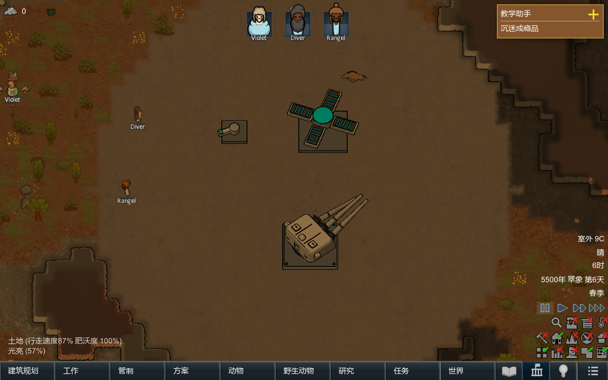
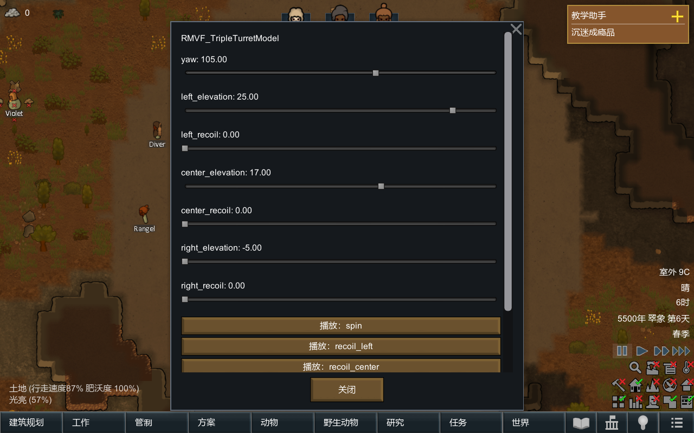

# 从空目录到会动的建筑

[English](quickstart.en.md) · [中文首页](../README.md) · [模型格式](model-format.md) · [接口说明](api.md)

本教程介绍如何安装示例、创建自己的MOD、修改模型并导入建模软件制作的部件。命令行步骤使用完整仓库作为工作目录。

## 1. 运行示例

将仓库中的 `Mod` 和 `Examples/Mechanisms` 文件夹分别复制到游戏的 `Mods` 目录，并分别重命名为 `MechanicalVisualFramework` 和 `RMVFExamples`。在游戏的 MOD 列表中按 Core、框架、示例的顺序启用。进入用于测试的地图，在“杂项”菜单建造示例，选中后打开“动画控制”调节参数或播放动作。启用开发者模式时也可通过生成建筑功能放置`RMVF_Starter`、`RMVF_Deployment`、`RMVF_TripleTurret`。

暂停游戏会停止动画时钟。直接拖动参数改变的是目标值，部件按配置速度逐渐移动。播放动作会接管其使用的参数；手动修改该参数会停止占用它的动作。

动画控制面板直接显示模型中的参数名和动作名，例如 `yaw`（转向角度）、`left_elevation`（左炮管仰角）。这些名称与源文件一致，便于作者查找；通用按钮与说明提供英文和简体中文。





## 2. 配置工具

双击项目根目录的 `Start.cmd` 打开工具箱，选择 **Configure paths（配置路径）**。在 Python 项填写已安装的 Python 3.10 或更新版本的程序路径，例如 `C:/Python312/python.exe`。若在命令行输入 `python` 可以正常启动 Python，也可以直接填写 `python`。只有要编译框架或运行自动游戏测试时才需要填写游戏目录与Roslyn的`csc.exe`。配置保存在`ToolPaths.local.json`，不会进入发布包。

不使用菜单时，以下命令都从仓库根目录运行。将`python`换成自己的Python可执行文件也可以：

```text
python Tools/new_project.py D:/MyMechanicalMod --id yourname.mechanism --name "My Mechanism"
```

工具会创建输出目录，因此应填写一个尚不存在的文件夹路径。生成的文件夹就是新 MOD，可复制到游戏的 `Mods` 目录，并在本框架之后启用。修改About中的作者、名称和说明；保留复用代码/素材所需的原作者版权说明。**不要将框架DLL复制进每个使用框架的MOD**。

## 3. 第一个改动

打开新MOD的`Authoring/model.json`。起步模型由底座和旋转臂组成。可以修改 `arm` 节点下 `box` 的 `size`（尺寸）或 `material`（材质编号），也可以修改 `yaw` 参数的 `speed`（转速）。保存后执行：

```text
python Tools/assets.py D:/MyMechanicalMod/Authoring/model.json D:/MyMechanicalMod yourname_mechanism
```

最后一个参数是模型资源名称，须与该 MOD 的 `Models/名称/` 文件夹一致。新建工具会把 packageId 中的点改为下划线：例如 `yourname.mechanism` 对应 `yourname_mechanism`。命令会生成模型 XML、二进制几何文件和色板贴图。退出并重启游戏后查看结果；本版不会在游戏运行期间重新加载这些文件。

先做小规模改动，再添加子部件。转轴位置写在节点position中，网格顶点必须相对于这个转轴；把整个模型的世界坐标直接当局部坐标，会造成部件绕错误的位置旋转。

## 4. 从建模软件接入

在支持GLB 2.0的建模软件中，将每个需要独立运动的刚性部件设为独立节点，并设置父子关系与原点。将非均匀缩放应用到几何后，导出静止模型，**关闭动画和纹理导出**。导出文件还需满足下列格式条件。

```text
python Tools/import_glb.py D:/model.glb D:/MyMechanicalMod/Authoring/imported.json
```

支持：一个内嵌二进制缓冲、三角形、FLOAT类型的POSITION顶点坐标、由平移和旋转及正值均匀缩放组成的节点变换（TRS）、最多15种纯色材质。保留层级和节点原点，并把glTF的Y向上转为框架的Z向上。仅导入所选场景。

不支持：矩阵节点、非均匀/负缩放、稀疏访问器、纹理、透明材质、骨骼、形变目标、GLB动画和文件声明为必需的扩展。遇到这些情况明确报错；应在建模软件导出前处理。基础颜色转换成色板，原PBR光照和材质质感不会保留。所有面采用框架的平面光照与轮廓。

导入后，在 JSON 中添加 `parameters`（可调参数）、`bindings`（参数控制哪些部件）、`clips`（动作）和 `anchors`（炮口等指定位置）。将贴地底座节点的 `layer` 设为 `foundation`；需要显示在地图物品上方的部件设为 `raised`。字段含义见[模型格式](model-format.md)。随后按上一节的命令，用 `Tools/assets.py` 生成游戏资源。**GLB文件只在制作阶段使用，游戏运行读取的是编译后的资源。**

GLB格式依据[Khronos glTF 2.0规范](https://registry.khronos.org/glTF/specs/2.0/glTF-2.0.html)。

## 5. 参考哪一个例子

- Starter：学习坐标、父子节点、旋转参数。
- Deployment：学习一个旋转父节点下的多关节折叠，同时播放独立升降/旋转。
- TripleTurret：学习独立俯仰、旋转后的局部后坐和三个炮口挂接点。需要攻击功能时，由自己的游戏逻辑调用动画接口。
- [ShieldGenerator建模案例](../Modeling/ShieldGenerator/README.md)：学习统一构件的四角装配、正交投影，以及球盖与基座的分层导出。

自行建模的面数从数百开始。运行开销主要受三角面数、轮廓边数和活动部件数影响。制作尺寸与游戏占地独立设置；调整ThingDef.size不会缩放模型。

